<div align="center">


# Download Speed Manager

**Fast, multi-connection downloads for Windows, with browser capture and signed automatic updates.**

[](https://github.com/mayankhansraj12/download-speed-manager/actions/workflows/ci.yml)
[](https://github.com/mayankhansraj12/download-speed-manager/releases/latest)
[](#install)
[](https://dotnet.microsoft.com/download/dotnet/10.0)
[](LICENSE)

[**Download**](https://github.com/mayankhansraj12/download-speed-manager/releases/latest) ·
[Features](#features) ·
[Screenshots](#screenshots) ·
[Browser extension](#browser-extension) ·
[How it works](#how-it-works) ·
[Build from source](#build-from-source)

<br>

<picture>
  <source media="(prefers-color-scheme: dark)" srcset=".github/assets/hero-dark.png">
  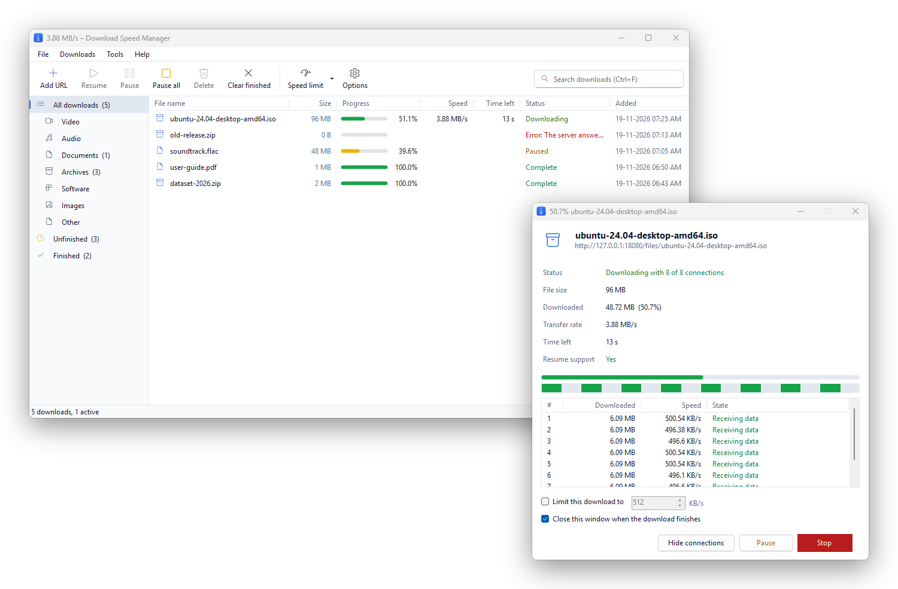
</picture>

</div>

## Features

<table>
<tr>
<td width="50%" valign="top">

### Fast
- Up to **32 connections per file**, each writing straight into a pre-allocated file
- **Speed-aware takeover**: a connection that finishes early takes over the slowest remaining part, so downloads don't stall at 99%
- Reconnects silent connections and adapts when a server limits connections (HTTP 429/503)

</td>
<td width="50%" valign="top">

### Reliable
- **Pause and resume**, even after a restart or a crash; files that changed on the server are detected
- **Queue** with a limit on simultaneous downloads
- **Speed limits** for everything at once or for each download

</td>
</tr>
<tr>
<td width="50%" valign="top">

### Integrated
- **Browser extension** for Chrome, Edge, Brave and Firefox, with cookies and referrer carried over
- **Clipboard catching** that ignores links restored by dictation tools
- Notification-area icon, taskbar progress, and familiar command-line switches

</td>
<td width="50%" valign="top">

### Safe and up to date
- **One-click, signed updates** for the app and the browser extension, checked automatically and verified with ECDSA P-256 and SHA-256
- **Per-user installer**: no administrator rights, clean uninstall
- **No telemetry**: it only contacts the servers you download from, and GitHub for updates

</td>
</tr>
</table>

## See it in action

<p align="center">
  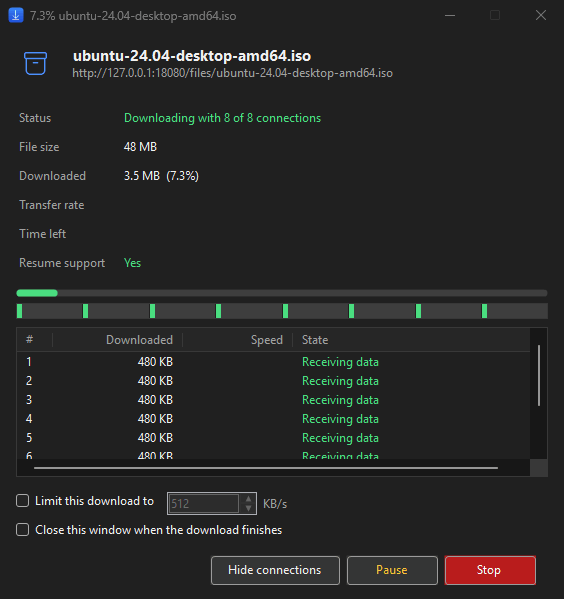
</p>

<p align="center"><sub>A 48 MB download over eight connections. Each block in the map is one connection's part of the file.</sub></p>

## Install

1. Download **`DownloadSpeedManager-Setup-<version>.exe`** from the [latest release](https://github.com/mayankhansraj12/download-speed-manager/releases/latest).
2. Run it. It installs for your Windows account only, without administrator rights.
3. Add the [browser extension](#browser-extension) to catch downloads from your browser.

**Requirements:** Windows 10 or 11 (64-bit) and the free [.NET 10 Desktop Runtime](https://dotnet.microsoft.com/download/dotnet/10.0). If the runtime is missing, Windows offers to download it when setup starts.

> [!NOTE]
> Releases aren't code-signed yet, so Windows SmartScreen may show *Windows protected your PC* the first time. Choose **More info → Run anyway**. Updates after that install without the warning, and each release's checksums are in `SHA256SUMS.txt`.

<details>
<summary><b>Portable version and silent install</b></summary>

<br>

- **Portable:** `DownloadSpeedManager-<version>-portable.zip` runs from any folder. It tells you about new versions but can't install them itself.
- **Silent install:** `DownloadSpeedManager-Setup-<version>.exe /S [/D=folder] [/desktop | /nodesktop] [/run]`
- **Silent uninstall:** `"%LOCALAPPDATA%\Programs\Download Speed Manager\Uninstall.exe" /uninstall /S [/removedata]`

Settings and the download list are kept in `%APPDATA%\DownloadSpeedManager`, so updates and reinstalls never touch them.

</details>

## Screenshots

<table>
<tr>
<td colspan="2" align="center">
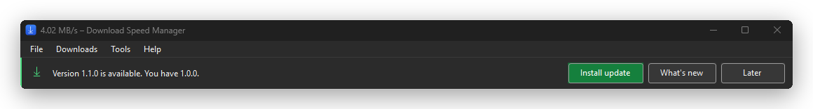
<br><sub><b>Updates</b>: offered as soon as a release is published, or installed by themselves if you allow it</sub>
</td>
</tr>
<tr>
<td width="50%" align="center">
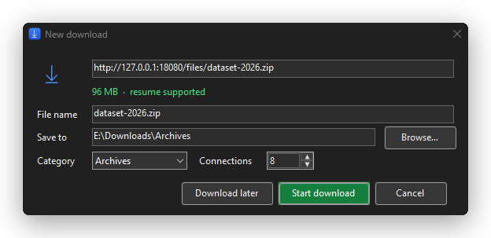
<br><sub><b>New download</b>: size and resume support are checked before it starts</sub>
</td>
<td width="50%" align="center">
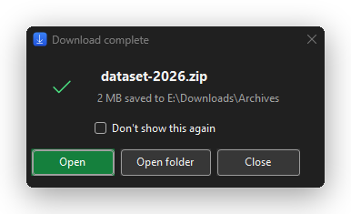
<br><sub><b>Done</b>: open the file or its folder</sub>
</td>
</tr>
<tr>
<td width="50%" align="center">
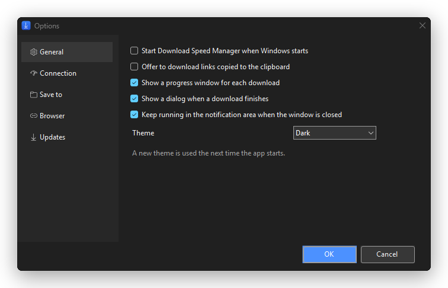
<br><sub><b>Options</b>: dark, light, or follow Windows</sub>
</td>
<td width="50%" align="center">
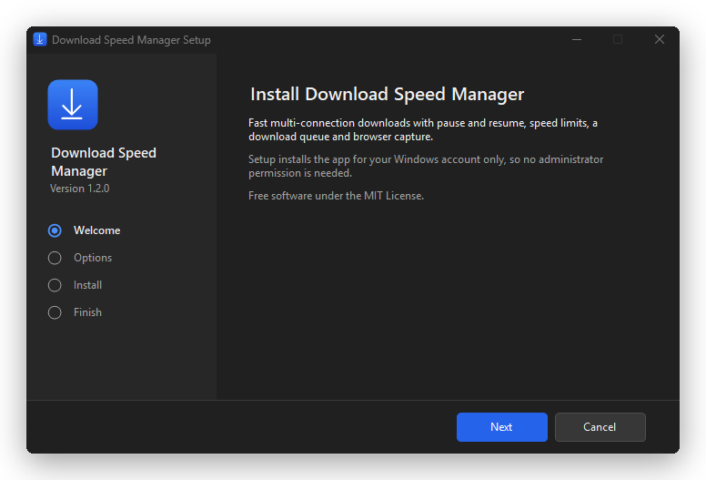
<br><sub><b>Setup</b>: per-user install with a clean uninstaller</sub>
</td>
</tr>
</table>

## Browser extension

The extension hands downloads from Chrome, Edge, Brave and Firefox to the app through native messaging, the mechanism password managers use to talk to their desktop apps. No local web server is involved, so websites can't reach the app.

<table>
<tr>
<td width="36%" align="center" valign="top">
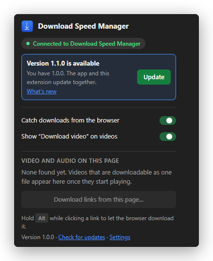
<br><sub><b>Popup</b>: status, updates, on/off switches and media found on the page</sub>
</td>
<td width="64%" align="center" valign="top">

<br><sub><b>Download video</b>: a button over videos that come from a single file</sub>
</td>
</tr>
<tr>
<td colspan="2" align="center">
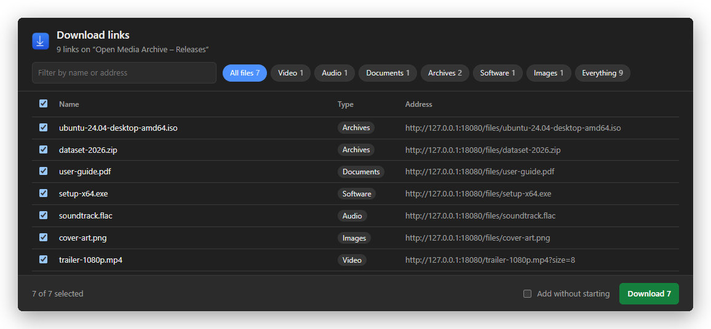
<br><sub><b>Link picker</b>: download every file on a page in one go, filtered by type</sub>
</td>
</tr>
</table>

- **Catch downloads** you start in the browser, with file types and a minimum size you choose. Hold <kbd>Alt</kbd> while clicking to let the browser download instead.
- **Right-click menu**: *Download with Download Speed Manager*, *Download this video or audio*, and *Download all links*.
- **Updates**: the toolbar icon shows **↑** when a new version is out. **Update** in the popup installs it, and the extension reloads itself once the app has put the new files in place.
- If the app isn't running, the browser starts it; if it isn't installed, the browser simply downloads as usual.

**Install it:** open `chrome://extensions` (or `edge://extensions`), turn on **Developer mode**, choose **Load unpacked** and select the `extension` folder in the app's install folder (**Options → Browser → Open extension folder**). Loading it from there lets it update together with the app. In Firefox, open `about:debugging#/runtime/this-firefox` and choose **Load Temporary Add-on**.

## How it works

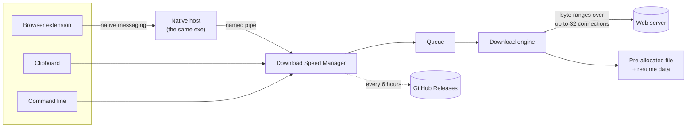

**Segmented downloads.** The engine asks the server for the file's size and checks that it supports byte ranges. It then splits the file across connections, and each one writes its part directly at the right offset. Progress is saved in a small `.part.dsm` file next to the download, so it can resume after a restart. If the file changed on the server in the meantime, `If-Range` validators detect it.

**Speed-aware takeover.** Every connection's speed is measured. When a connection finishes its part, it takes over the end of whichever part will finish last, split so that both finish at the same time. That removes the long tail where one slow connection holds up the whole download.

**Signed updates.** Each release publishes a small `latest.json` with the new version and its installer's SHA-256, signed with the project's private key. The app checks it automatically (every hour, 6 hours or day; you choose in **Options → Updates**), or right away from **Help → Check for updates**, the notification-area menu or the extension's popup. It verifies the signature with the public key built into it, downloads the installer, checks its checksum, then installs silently and restarts. Downloads that were running carry on. The extension's files ship inside the app, so they update in the same step, and the extension reloads itself when it sees them.

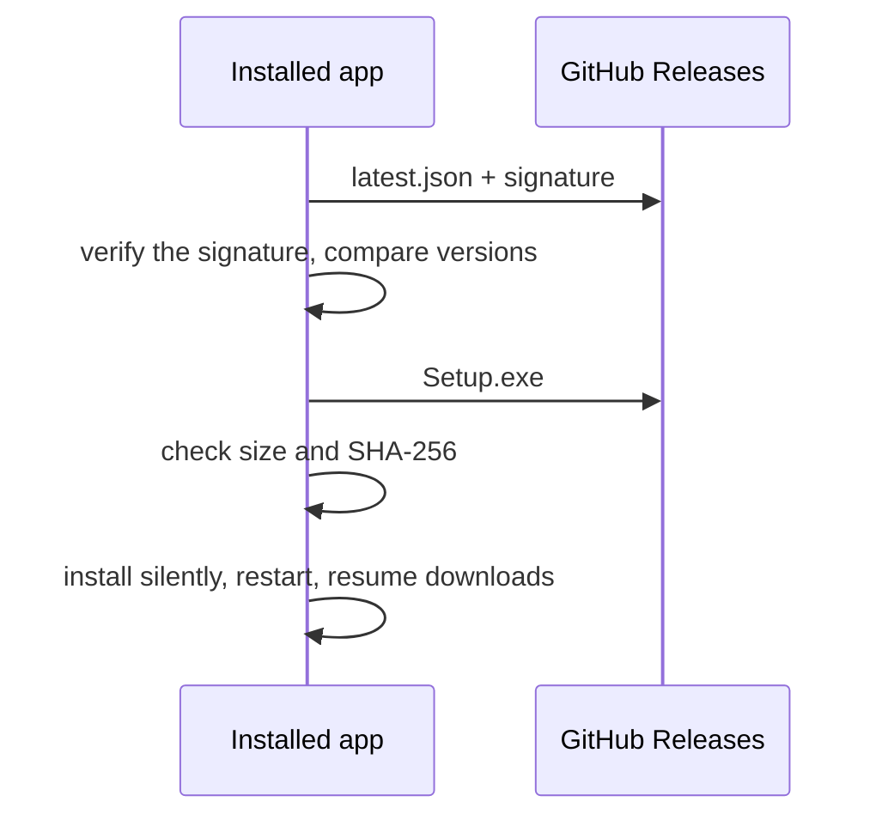

## Performance

The same 100 MB file on the same machine and connection, downloaded back to back with 16 connections. Measured with the cross-platform engine, which shares its segmentation algorithm with the Windows app:

| Downloader | Time | Average speed |
|---|---|---|
| Internet Download Manager | 27.1 s, 26.1 s | 3.8 MB/s |
| Download Speed Manager, simple halving splits | 33.0 s | 3.0 MB/s (11 s stuck at 99%) |
| **Download Speed Manager, speed-aware takeover** | **21.6 s, 21.4 s** | **4.7 MB/s** |

Every run produced a file with the same SHA-256. Results depend on the server and your connection.

## Command line

```text
DownloadSpeedManager.exe /d <url> [/p <folder>] [/f <file name>] [/n] [/a]
DownloadSpeedManager.exe /s        start everything waiting in the queue
DownloadSpeedManager.exe --tray    start hidden in the notification area
DownloadSpeedManager.exe --update  check for a new version now and install it
```

`/n` adds without asking and `/a` adds without starting. If the app is already running, the command is passed to it.

<details>
<summary><b>Cross-platform engine (Node.js) with web UI and CLI</b></summary>

<br>

The same download engine also runs on Windows, macOS and Linux with Node.js 20 or newer, with no dependencies to install.

```bash
npm start                                                   # web UI at http://127.0.0.1:9614
node src/cli.js <url> [-c 16] [-o ~/Downloads] [-n name.zip] [-l 2m]
```

| Environment variable | Default | Purpose |
|---|---|---|
| `DSM_PORT` | `9614` | Port of the local UI and API |
| `DSM_DOWNLOAD_DIR` | `~/Downloads` | Initial download folder |
| `DSM_DATA_DIR` | `./data` | Download list and settings |
| `DSM_IP_FAMILY` | `ipv4` | `auto` uses the operating system's IPv6/IPv4 order |

The server listens on `127.0.0.1` only. It rejects requests with an unexpected `Host` header (DNS rebinding) and any request from a web page, so websites can't add downloads or read your list. Cookies from the browser are kept only to resume downloads, are never returned by the API, and are dropped when a download redirects to another site.

</details>

## Build from source

You need Windows 10 or 11, the [.NET 10 SDK](https://dotnet.microsoft.com/download/dotnet/10.0), and [Node.js](https://nodejs.org/) 20 or newer for the cross-platform engine.

```powershell
git clone https://github.com/mayankhansraj12/download-speed-manager.git
cd download-speed-manager

dotnet run --project windows/DSM.Tests -c Release            # engine, updater and clipboard tests
npm test                                                     # Node.js engine tests
dotnet run --project windows/DSM                             # run the app
powershell -ExecutionPolicy Bypass -File windows\build.ps1   # installer, portable zip and extension in dist\
```

Copies you build yourself have no update source, so they never replace themselves with a release. Releases are built by GitHub Actions when a version tag is pushed; see the [release workflow](.github/workflows/release.yml).

<details>
<summary><b>Project structure</b></summary>

<br>

```text
windows/
  DSM/                  the Windows app
    Engine/             HTTP, segments and takeover, speed limits, queue
    Ui/                 main window, dialogs, progress window, notification-area icon
    Integration/        native-messaging host, browser registration, clipboard, command line
    Updates/            update check, signature and checksum verification
  DSM.Setup/            installer and uninstaller
  DSM.Tests/            tests against local test servers
  tools/                release tool (sign and verify updates), icon renderer, update test
  build.ps1             builds a release into dist\
extension/              browser extension (Manifest V3)
src/, public/, test/    cross-platform Node.js engine, web UI and tests
.github/workflows/      CI and release pipelines
```

</details>

## Roadmap

- [ ] Code-signed releases
- [ ] WinGet package
- [ ] Extension listings on the Chrome Web Store, Edge Add-ons and Firefox Add-ons
- [ ] Download scheduler
- [ ] Streaming video (HLS/DASH) and FTP

## Contributing

Bug reports, ideas and pull requests are welcome. [CONTRIBUTING.md](CONTRIBUTING.md) explains how to set up, test and send a change, and [CHANGELOG.md](CHANGELOG.md) lists what changed in each version. Please report security problems privately, as described in [SECURITY.md](SECURITY.md).

## License

[MIT](LICENSE). Download Speed Manager is an independent project and is not affiliated with Internet Download Manager or its publisher.
