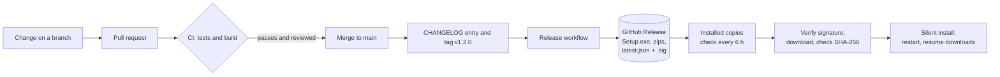
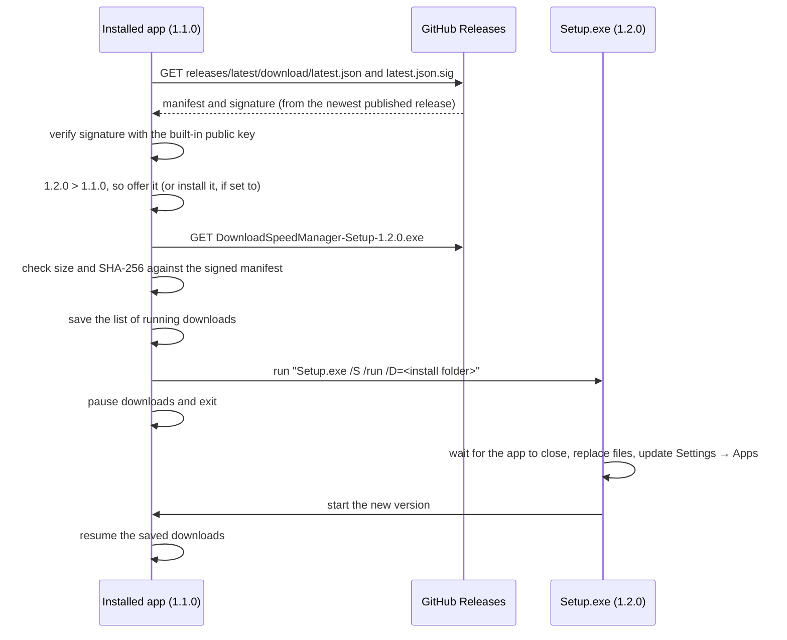

# Release and update lifecycle

How a change gets from your editor to everyone who has Download Speed Manager installed, and
why each step exists. It covers versioning, CI, cutting a release, how the app updates itself,
how updates are kept safe, key management, code signing, distribution and recovery.

**The short version:** you merge changes into `main`, then push a tag such as `v1.2.0`. GitHub
Actions tests and builds the release, writes a small signed file called `latest.json`, and publishes
everything as a GitHub Release. Every installed copy checks that file every few hours. When it finds a
newer version whose signature is valid, it downloads the installer, checks the installer's fingerprint,
installs it silently and restarts. Downloads that were running then carry on.



## 1. Versions

Versions follow [Semantic Versioning](https://semver.org/): `MAJOR.MINOR.PATCH`.

| Part | Raise it when | Example |
|---|---|---|
| PATCH (1.2.**3**) | you fix bugs and nothing else changes | the clipboard fix for dictation tools |
| MINOR (1.**3**.0) | you add something, and old settings and scripts keep working | a download scheduler |
| MAJOR (**2**.0.0) | something stops working the old way | a renamed command-line switch, a settings format that can't be read back |

**The git tag is the single source of truth.** Nothing in the repository stores the version of a
release. The tag `v1.2.0` flows through the release like this:

- The workflow reads it and passes `-Version 1.2.0` to [`windows/build.ps1`](../windows/build.ps1).
- MSBuild stamps it into both exes. The app reads it back in `UpdateService.CurrentVersion` (shown under
  Help → About), and Setup writes it to Settings → Apps.
- The build copies it into the extension's `manifest.json`, and into every file name.

Builds made on your own machine use the default `1.0.0` from
[`windows/Directory.Build.props`](../windows/Directory.Build.props). They have no update source, so a copy
you are testing never replaces itself with a release.

## 2. Everyday development: continuous integration

Work happens on branches and reaches `main` through pull requests. [`ci.yml`](../.github/workflows/ci.yml)
runs on every pull request and every push to `main`:

| Job | Runs on | What it does |
|---|---|---|
| Windows app | `windows-latest` | runs `windows/DSM.Tests` (engine, updater and clipboard tests), builds the release tool, then builds the installer, portable zip and extension zip and keeps them for 14 days as a downloadable artifact |
| Node engine and browser extension | `ubuntu-latest` | runs `npm test`, syntax-checks every extension script and checks the manifest |

CI test builds are versioned `0.0.<run number>` and have no update source. You can install one to try a
pull request, and it will never update itself.

**Turn on branch protection** (see the [one-time setup](#10-one-time-setup)): require a pull request
and both CI checks before anything merges into `main`. That makes "`main` is always releasable" a
rule rather than a habit.

## 3. Cutting a release

1. **Write the release notes.** In [CHANGELOG.md](../CHANGELOG.md), move the lines under
   `## [Unreleased]` into a new section such as `## [1.2.0] - 2026-12-01`. Merge that through a pull
   request like any other change.
2. **Tag the release on `main`, then push the tag:**

   ```powershell
   git checkout main
   git pull
   git tag v1.2.0
   git push origin v1.2.0
   ```

3. **Watch it run** under the repository's **Actions** tab, in **Release**. It takes about five minutes.

[`release.yml`](../.github/workflows/release.yml) does the following:

| Step | Why |
|---|---|
| Checks the tag looks like `v1.2.0`, is on `main`, and has a CHANGELOG section | only reviewed code is released, and every release explains itself |
| Runs the tests again | the tag might point at a commit that never passed CI |
| `build.ps1 -Version 1.2.0 -Repository <owner>/<repo>` | builds the installer, zips and checksums, and bakes the update source into the app |
| `ReleaseTool manifest` | writes `latest.json`: the version, the installer URL, its size and its SHA-256 |
| `ReleaseTool sign` using the `UPDATE_SIGNING_KEY` secret | writes `latest.json.sig`, the proof that you published it |
| `ReleaseTool verify` against the public key in the repository | stops the release if the secret isn't the key the app trusts, which would otherwise ship an update that nobody installs |
| Records build provenance | anyone can check a file came from this workflow: `gh attestation verify <file> --repo <owner>/<repo>` |
| Creates a draft release, uploads everything, then publishes it | installed copies follow "the latest release", which must never point at a release that is still uploading |

Within six hours, every installed copy that is running will have offered the update. Anyone can
get it straight away with **Help → Check for updates**.

**If the workflow fails:** fix the cause on `main`, then delete the tag and push it again:
`git tag -d v1.2.0`, `git push origin :refs/tags/v1.2.0`, then `git tag v1.2.0` and `git push origin v1.2.0`.
If it failed after creating the draft release, delete that draft on the Releases page first.
Nothing reaches users until the last step, so a failed run is harmless.

## 4. How the app updates itself



**When it checks:** 20 seconds after the app starts, then every 6 hours while it runs. You can also check
with Help → Check for updates, or with Options → Updates → Check now. The same Options page turns
automatic checks off, and turns on installing without asking.

**Where it looks:** `https://github.com/<owner>/<repo>/releases/latest/download/latest.json`. GitHub
redirects `releases/latest/download/<file>` to that file in the newest published release, leaving out
drafts and pre-releases. That is why the project needs no update server of its own. GitHub Releases is
the server, and it costs nothing for a public repository.

A `latest.json` looks like this:

```json
{
  "version": "1.2.0",
  "publishedAt": "2026-12-01T10:15:00+00:00",
  "notesUrl": "https://github.com/<owner>/<repo>/releases/tag/v1.2.0",
  "setup": {
    "url": "https://github.com/<owner>/<repo>/releases/download/v1.2.0/DownloadSpeedManager-Setup-1.2.0.exe",
    "sha256": "4230A4184993ABB20DF16CF56D6332E88E8E1F84B8E4ED34EE6EF2B1970263C2",
    "size": 473357
  }
}
```

An optional `minimumVersion` field marks the update as important for older copies, and the bar then
says so. To set it, add a repository variable called `UPDATE_MINIMUM_VERSION`.

**What people see:** a bar under the toolbar, reading "Version 1.2.0 is available", with **Install update**,
**What's new** and **Later**. A notification also appears once for each new version. If installing
without asking is on, the update installs by itself, but only when no download is running.

**Details that make it smooth:**

- **No admin prompt.** The app is installed per user, in `%LOCALAPPDATA%\Programs`, so the installer runs
  without a UAC prompt.
- **No SmartScreen prompt during updates.** Files the app downloads don't carry the browser's
  "downloaded from the internet" mark, so Windows doesn't stop the silent installer. The *first* install,
  from a browser, still meets SmartScreen; see [code signing](#7-code-signing-and-smartscreen).
- **Data is never touched.** Settings and the download list live in `%APPDATA%\DownloadSpeedManager`,
  outside the install folder, so an update can't damage them.
- **Shortcuts stay as the user left them.** A silent install keeps the desktop shortcut if there is one,
  and doesn't add one if the user deleted it.
- **Downloads carry on.** Downloads that were running are saved to `resume-after-update.json` and
  resumed by the new version. Their partial files are kept, so nothing is downloaded twice.

**Copies that can't update themselves:** a portable copy (from the zip) only shows the bar, and its
button opens the releases page. A copy you built yourself has no update source at all.

## 5. How updates stay safe

An auto-updater is the most powerful feature an app has. Whoever controls it can run code on every
machine that has the app. So the app trusts **a key, not a server**.

| What could go wrong | What stops it |
|---|---|
| Someone tampers with the connection | HTTPS, plus the signature: a changed manifest fails verification |
| Someone uploads a different `Setup.exe` to a release, or edits `latest.json` | the manifest must be signed by the private key, and the installer must match the signed SHA-256 and size; anything else is deleted unused |
| Someone serves an old, correctly signed release | the app only ever moves to a **newer** version, so it can't be downgraded to an older build with known bugs |
| A huge or endless response | the manifest is capped at 1 MB, and the installer must match the size in the signed manifest |
| The installer is fetched over plain HTTP | refused; only HTTPS is accepted (loopback is allowed for local tests) |

What the signature does **not** protect against, so these must be guarded separately:

- **Someone gets write access to the repository.** They could run a workflow that uses the
  `UPDATE_SIGNING_KEY` secret. Defend against this with two-factor authentication on your GitHub
  account, branch and tag protection, and the `release` environment set to require your approval. With
  approval required, no workflow run can touch the secret until you approve it.
- **Your own computer is compromised.** The private key file is on it. Keep the backup offline and the
  file out of synced folders.
- **Someone blocks the update check.** An attacker who can block your network can stop you from seeing
  updates, but can't make you install anything.

**Two different signatures.** The update signature (ECDSA) answers *"did this project publish this
release?"*. Only the app checks it. Authenticode code signing answers *"who made this file?"* for Windows
and SmartScreen. They solve different problems. This project has the first, and the second is optional
(see §7).

## 6. Key management

| Item | Where it lives |
|---|---|
| Private key (signs releases) | `%USERPROFILE%\.dsm-release\update-signing-key.pem` on your computer, **and** the `UPDATE_SIGNING_KEY` secret on GitHub, **and** an offline backup. Never in the repository: `.gitignore` excludes `*.pem` |
| Public key (checks releases) | [`windows/DSM/Updates/update-public-key.txt`](../windows/DSM/Updates/update-public-key.txt), compiled into the app |

**Make a key pair** (already done for this project, and it refuses to overwrite an existing key):

```powershell
dotnet run --project windows/tools/ReleaseTool -- keygen --private "$env:USERPROFILE\.dsm-release\update-signing-key.pem" --public windows/DSM/Updates/update-public-key.txt
```

**Give it to GitHub:** go to Settings → Environments → `release` → Add secret. Name it
`UPDATE_SIGNING_KEY`, and paste the whole `.pem` file, including the `BEGIN` and `END` lines. With the
GitHub CLI, you can do the same in one command:
`gh secret set UPDATE_SIGNING_KEY --env release < "$env:USERPROFILE\.dsm-release\update-signing-key.pem"`.

**Back it up** somewhere offline, such as a password manager or an encrypted USB stick. If the key is
lost, installed copies can never accept another update, and everyone would have to reinstall by hand.

**Rotating the key on a schedule, or when moving to new hardware:**

1. Make a new pair, and **add** the new public key as a second line in `update-public-key.txt`.
2. Release normally, still signing with the old key. Installed copies now trust both keys.
3. Once most copies have updated, replace the secret with the new private key. Releases are signed
   with it from now on.
4. A few releases later, remove the old public key line.

**If the private key leaks:** rotate as above, but straight away. Remove the old public key in the same
release that adds the new one, and sign that release with the old key, so installed copies accept it. From
then on, those copies trust only the new key. Until people install that release, whoever has the
leaked key could sign an update. That window is why the key's secrecy matters more than anything else
here.

## 7. Code signing and SmartScreen

When someone downloads an unsigned `Setup.exe` with a browser and runs it, Windows SmartScreen may
show "Windows protected your PC". They have to choose **More info → Run anyway**. Reputation is built
per file and per publisher. With no signature, every release is a new, unknown file, so the warning
returns with each version.

Signing the exes with an Authenticode certificate ties them to a verified publisher identity, so
reputation builds up over releases. Options for an open-source project:

| Option | Cost | Notes |
|---|---|---|
| [SignPath Foundation](https://signpath.org/) | free for open-source projects | you apply; files are signed by the foundation's certificate, from your CI, after a policy check |
| Azure Trusted Signing (Microsoft) | low monthly fee | identity validation required; availability depends on your country and whether you sign up as an individual or an organisation |
| A code-signing certificate from a certificate authority | yearly fee | keys must be on hardware or a cloud HSM, so it is usually used through a cloud signing service |

Microsoft has said that even EV certificates no longer skip SmartScreen's reputation check outright, so
expect warnings for the first releases whichever option you choose.

**Plugging it in:** set the `DSM_SIGN_SCRIPT` environment variable to a script that signs the file path
it is given. `build.ps1` then calls it for the app exe before it is zipped, and for `Setup.exe` before
checksums and `latest.json` are made. In `release.yml`, add a step before **Build** that prepares the
signing service, and set the variable for the Build step. Signing must come before checksums. A file
changes when it is signed, and the update would otherwise fail its own hash check.

## 8. Distribution beyond GitHub Releases

- **.NET runtime.** The app and Setup are framework-dependent, which keeps the installer under 1 MB.
  People need the free [.NET 10 Desktop Runtime](https://dotnet.microsoft.com/download/dotnet/10.0). If it
  is missing, Windows shows a prompt with a download link when Setup starts. If that friction matters, a
  self-contained build bundles the runtime instead (`--self-contained true`). The installer is then tens of
  megabytes, even compressed.
- **WinGet.** Users could run `winget install` for the app. Submit a manifest to `microsoft/winget-pkgs`,
  for example with `wingetcreate`. The installer type is `exe`, the silent switch is `/S`, and the scope is
  `user`. WinGet then follows your GitHub Releases, and the app's own updater keeps working alongside it.
- **Browser extension stores.** Today the extension is loaded unpacked, from the release zip or the
  install folder. To publish it on the Chrome Web Store (one-time developer fee), Edge Add-ons or Firefox
  Add-ons:
  - Remove the `key` field from `manifest.json` in the store upload. Stores assign their own ID.
  - Add that ID to `allowed_origins` in
    [`BrowserIntegration.cs`](../windows/DSM/Integration/BrowserIntegration.cs), so the app accepts the
    store version.
  - Stores update extensions themselves. Release the extension and the app together when the messages
    between them change.

## 9. When a release goes wrong

- **Fix forward.** The normal answer to a bad release is a quick patch release, such as 1.2.1. Installed
  copies, including ones that already took 1.2.0, move to it.
- **Stop it spreading while you fix it.** Edit the bad release on GitHub and tick **Set as a pre-release**.
  `releases/latest` then points back at the previous release, so copies that haven't updated stay where
  they are. Copies that already updated **won't go back**, because downgrades are refused by design.
  That makes the patch release the real fix.
- **Never change the files of a published release.** People may be part-way through downloading them,
  and `latest.json` holds their checksums. Publish a new version instead.
- **Mark an important update.** Set the `UPDATE_MINIMUM_VERSION` repository variable to the first good
  version. Copies older than it describe the update as important.

## 10. One-time setup

1. Create the repository on GitHub and push `main`.
2. **Settings → Environments → New environment `release`.** Add the `UPDATE_SIGNING_KEY` secret here
   (§6). Optionally add yourself under **Required reviewers**, so every release waits for your approval.
3. **Settings → Rules → Rulesets.** Protect `main`: require a pull request, and require both CI checks to
   pass. Add a tag ruleset for `v*`, so only you can create release tags.
4. **Settings → Code security.** Turn on private vulnerability reporting (it is what
   [SECURITY.md](../SECURITY.md) points to), Dependabot alerts and Dependabot security updates. Secret
   scanning is on by default for public repositories.
5. Turn on **two-factor authentication** for your GitHub account.
6. Back up the private key offline.
7. Release `v1.0.0` (§3), then install it from the Releases page. From then on, that copy updates itself.

## 11. Testing updates locally

[`windows/tools/test-update.ps1`](../windows/tools/test-update.ps1) acts out a whole update on your own
computer:

1. It builds 1.0.0 and 1.0.1.
2. It publishes 1.0.1 on a local feed, exactly as the release workflow does, signed with your real key.
3. It installs 1.0.0 into a test folder and starts it.
4. It waits while the app finds, verifies, installs and restarts into 1.0.1.

```powershell
powershell -ExecutionPolicy Bypass -File windows\tools\test-update.ps1
```

```text
[04:52:32] Installed 1.0.0 (setup exit code 0)
[04:52:32] Started 1.0.0 as PID 26216; waiting for it to update itself
[04:52:55] 1.0.0 exited so the installer could replace it
[04:52:55] Running 1.0.1 as PID 9800, 22 s after the first start

exe version                : 1.0.1
Settings > Apps version    : 1.0.1
extension files installed  : True
download list kept         : True
resume file consumed       : True
installer hash = published : True
old process gone           : True
```

The test uses its own data folder. It backs up your real installation's Settings → Apps entry,
shortcuts and browser registrations, and puts them back afterwards. A copy of the app that is already
running is left alone.

To point any copy at a test feed by hand, set `DSM_UPDATE_FEED` to the folder URL that holds `latest.json`
and `latest.json.sig`. Signatures are still required.

The unit tests in `windows/DSM.Tests` cover the rejection cases one by one: a wrong key, a manifest
edited after signing, a missing or malformed signature, an older version, an altered or oversized
installer, and plain HTTP.

## 12. Where everything lives

| File | Role |
|---|---|
| [`.github/workflows/ci.yml`](../.github/workflows/ci.yml) | tests and test builds for every pull request |
| [`.github/workflows/release.yml`](../.github/workflows/release.yml) | builds, signs and publishes a release when a `v*` tag is pushed |
| [`.github/dependabot.yml`](../.github/dependabot.yml) | keeps the workflows' actions up to date |
| [`windows/build.ps1`](../windows/build.ps1) | builds the installer, portable zip, extension zip and checksums |
| [`windows/tools/ReleaseTool`](../windows/tools/ReleaseTool/Program.cs) | `keygen`, `manifest`, `sign`, `verify` |
| [`windows/DSM/Updates/UpdateService.cs`](../windows/DSM/Updates/UpdateService.cs) | checking, verifying, downloading and starting an update |
| [`windows/DSM/Updates/update-public-key.txt`](../windows/DSM/Updates/update-public-key.txt) | the public keys the app trusts |
| [`windows/DSM/Ui/Shell.cs`](../windows/DSM/Ui/Shell.cs) | when to check, the update bar, saving and resuming downloads around an update |
| [`windows/DSM.Setup`](../windows/DSM.Setup/Installer.cs) | the installer: closes the app, replaces files, keeps shortcuts, restarts |
| [`CHANGELOG.md`](../CHANGELOG.md) | release notes, published with each release |
